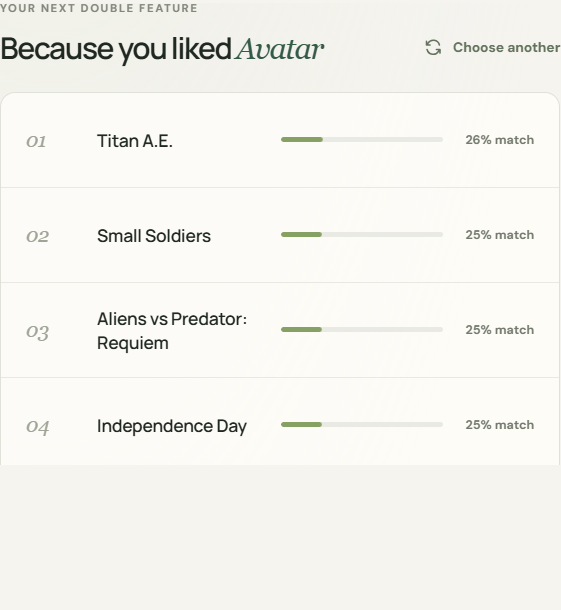

# Frame — Movie Recommender

[](https://movie-recommender-v4cr.onrender.com)

Frame is a content-based movie recommendation app. Search a title to discover
five films with similar stories, genres, keywords, cast, and directors. The
project pairs a FastAPI backend with a responsive web interface.

**[Try the live demo](https://movie-recommender-v4cr.onrender.com)** ·
**[API documentation](https://movie-recommender-v4cr.onrender.com/docs)**

## Screenshots

| Discover movies | Similar recommendations |
| --- | --- |
|  |  |

## Features

- Search a library of more than 4,700 movies by title.
- Get five recommendations ranked by cosine similarity.
- Compare movie overviews, genres, keywords, cast, and directors.
- Use the responsive web interface or call the JSON API directly.
- Run locally or deploy to Render using the included Blueprint.

## Run locally on Windows

### Requirements

- Python 3.10 or newer (Python 3.12 is recommended)
- Git
- An internet connection for the first-time dataset download

### Setup

Open PowerShell in the project directory and create a virtual environment:

```powershell
git clone https://github.com/sayan1243/Movie-recommender.git
cd Movie-recommender
py -3.12 -m venv .venv
.\.venv\Scripts\Activate.ps1
```

If you have another supported Python version, replace `-3.12` with that version
(for example, `-3.10`).

If PowerShell blocks environment activation, use `.venv\Scripts\python.exe`
instead of `python` for the following commands.

Install dependencies and build the recommendation model:

```powershell
python -m pip install --upgrade pip
python -m pip install -r requirements.txt
python build_model.py
```

The model builder downloads the TMDB 5000 movie metadata and credits to `data\`,
then creates the model in `model\`. These generated files are excluded from Git.

Start the app:

```powershell
python -m uvicorn app:app --host 127.0.0.1 --port 8000 --reload
```

Open [http://127.0.0.1:8000](http://127.0.0.1:8000) in your browser. Interactive
API documentation is available at [http://127.0.0.1:8000/docs](http://127.0.0.1:8000/docs).

## API

| Method | Endpoint | Description |
| --- | --- | --- |
| `GET` | `/api/health` | Service status and movie count |
| `GET` | `/api/movies?q=avatar` | Search movies by title; optional `limit` (1–20, default 8) |
| `GET` | `/api/movies/{movie_id}/recommendations` | Get similar movies; optional `limit` (1–10, default 5) |

The web interface is served by FastAPI from the `web\` directory. API schemas
and a try-it-out console are available at `/docs`.

## Deploy on Render

The included [`render.yaml`](render.yaml) configures a free Render web service.

1. Sign in to [Render](https://dashboard.render.com/) and connect your GitHub account.
2. Select **New > Blueprint**, then choose the
   [`sayan1243/Movie-recommender`](https://github.com/sayan1243/Movie-recommender)
   repository.
3. Review the Blueprint configuration and select **Apply**.
4. Wait for the build and deploy to finish, then open the service URL.

Render builds the model from the dataset during deployment. A free instance may
take a little while to wake after a period of inactivity.

## Project structure

```text
app.py          FastAPI application and recommendation API
build_model.py  Dataset download and content-vector model builder
web/            Frontend HTML, CSS, and JavaScript
render.yaml     Render Blueprint deployment configuration
```

The original notebook is intended for Kaggle and expects Kaggle's
`/kaggle/input/` directory; it is not needed to run the web app.
